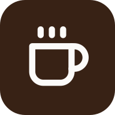

  

  # Cafe360

  **Discover cafés, keep your favorites, and share visits and memories with your Circle.**

  

    
    
    
    
    
    
  

  
<em>Your next coffee spot. Your Circle's shared story.</em> 
  A café map, personal collections, and memories from the places you visit together.

  [☕ Open Cafe360](https://cafe-360.vercel.app)

---

## 🚀 Get started

Sign in, complete your profile, then create a Circle or join through an invite. New accounts get an editable display-name suggestion from their email; choose your own username. An invite waits until profile setup is complete, then opens again so you can join. Existing members see **Open Circle** when reopening an invite.

## 🧭 Navigation

| Tap | What opens |
| --- | --- |
| **Map** | Café map and your selected Circle |
| **Saved** | Your personal collections and Favorites, including cafés outside the map area |
| **You** | Your profile, Edit Profile and Settings |
| Map **gear** | Settings; choose **Switch or manage Circles** to open Circle cards and details |
| **Circle name** above the map | Switch Circles, create, join, copy an invite or leave |
| **Search icon** | Search for a café |
| Top-right **list icon** | Nearby results from your completed map search |

## ☕ Find and save a café

1. Tap **Near Me**, search by name, or move the map and tap **Search this area**.
2. Tap a café pin or result to open its details.
3. Choose an action:

| Action | What it does |
| --- | --- |
| **Save** | Adds the café to your personal collection, Favorites by default |
| **Organize** | Choose or create a collection; a café can belong to several |
| **Save to Circle** | Share the café with your selected Circle |
| **I'm Interested** | Let your Circle know you want to visit |
| **Go** | Open directions |
| **Share** | Share or copy the café link |
| **Log** | Record a visit |

## 👥 Your Circle

Swipe up on the Circle sheet to see all members, shared cafés, Activity and Memories. Tap a section button to scroll to it. Your own member row opens **You**; another member opens their profile.

The sheet starts with the first member visible. Drag its header up to expand, down to return to normal, or farther down to leave only the header and section tabs. **See all** opens the full café, activity or memory list.

To open Circle details, use **gear → Switch or manage Circles → Circle card**. To invite someone, copy the invite from the Circle dropdown or details page. Members can leave; owners can delete their Circle.

## 📸 Visits and memories

Open a café and tap **Log**, or use **Check in** on the map. Choose the date, optional rating, companions, note and up to five photos, then tap **Save Visit**.

Find shared visits under **Memories** in the Circle sheet or café details. Use **Hours & Information → Add for Circle / Edit** to share café hours.

**Saved is personal.** Shared cafés, interests, ratings, hours and memories are visible to members of the selected Circle. Only the member who shared a Circle café can remove that shared save.

## ⚙️ Profile and settings

Use **You → Edit Profile** to change your name, username, bio or photo. **Settings** contains light/dark/system appearance and **Sign Out**. Settings also works before you join a Circle.

## 📱 Using Cafe360 on your phone

Install through your browser's **Install app** or **Add to Home Screen** option. Pinch the map to zoom. Allow location access to use **Near Me**.

Reconnect before saving changes; offline changes are not queued. If an unsaved-changes prompt appears, **Cancel** keeps your draft. Save before refreshing or closing the app.

## ⏳ Loading and retry

Ready cached pages open without a loading screen. While an action or page is loading, a spinner shows its progress. After 10 seconds, use **Try again** where offered or **Refresh page**. A slow save may still finish; check its latest status before submitting again.
